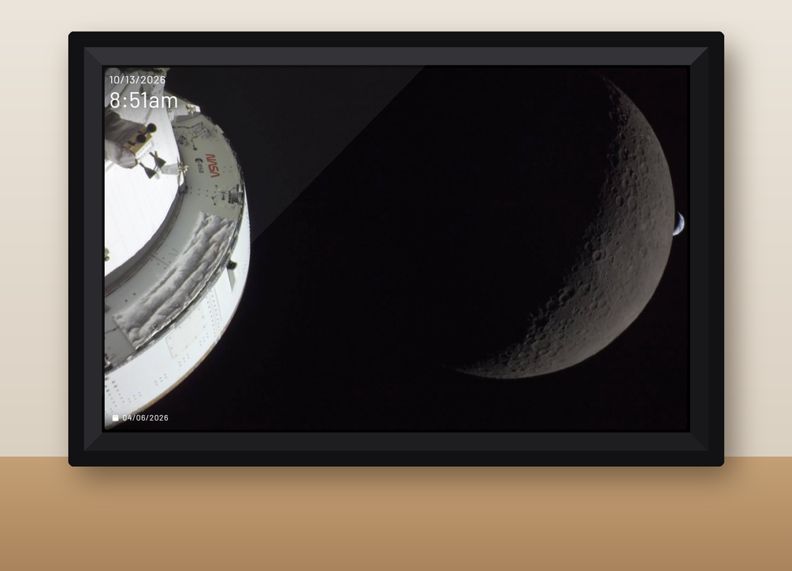
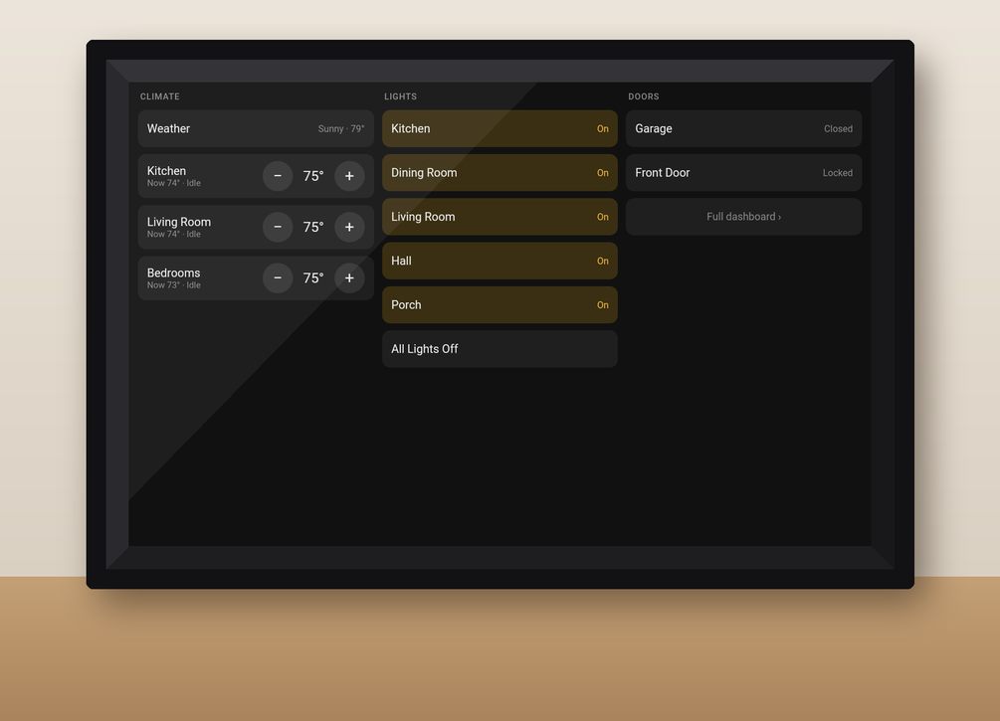
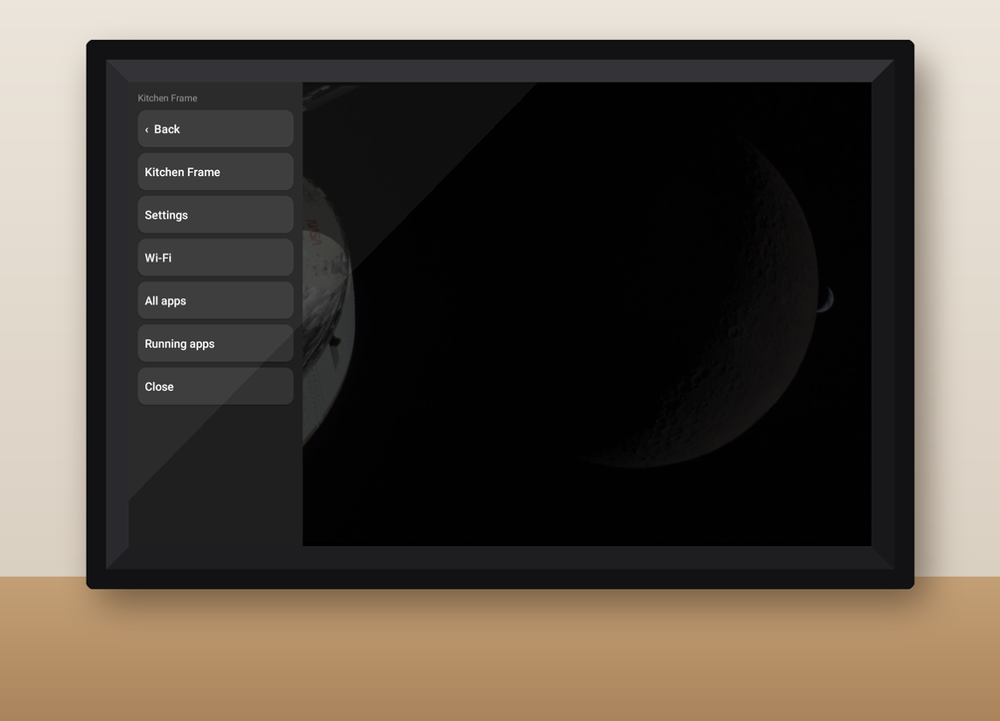
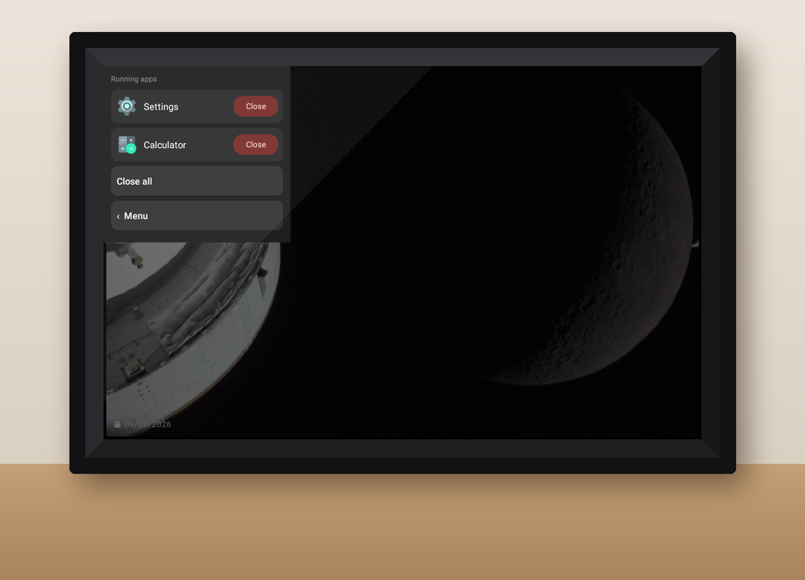
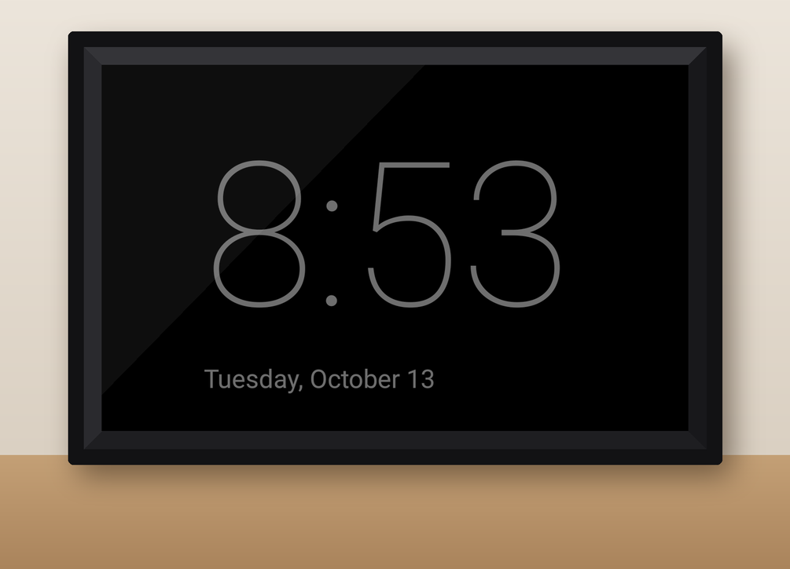

# photo-frame

Turn a cheap Frameo photo frame into a privacy-respecting wall display: an
[Immich](https://immich.app) slideshow by default, a lightweight
[Home Assistant](https://www.home-assistant.io) control panel on touch, and a dim clock at night.
No vendor cloud, no subscription, and the Frameo app removed entirely.

Inspired by Wes Bos's [photo-frame-dashboard](https://github.com/wesbos/photo-frame-dashboard),
which is the place to start for rooting, backing up and modernising these frames. This project
picks up where that leaves off: a kiosk app and control page built for one particular frame, plus
notes on what that frame's firmware does.

> **Read the warnings below before touching a frame.** This involves root, system-partition edits
> and low-level flashing. A mistake can leave a frame that won't boot.

## Screenshots

Captured on the frame itself (1280×800), shown in a drawn mock-up of the frame.



| | |
|---|---|
|  |  |
| **Control page** — tap the slideshow; back to photos after 30 s | **Edge menu** — swipe in from the left, over any app |
|  |  |
| **Running apps** — switch to or close anything left open | **Night mode** — a dim clock when the room's lights are off after sunset |

*Slideshow photos: NASA, Artemis II lunar flyby, 6 April 2026 (public domain). The buttons shown
are a demo layout.*

## What it does

- **Slideshow first.** Shows an [Immich Kiosk](https://github.com/damongolding/immich-kiosk)
  slideshow. Swipe left/right to flip photos (Kiosk keeps a history); a tap opens the controls.
- **Light control panel.** A single-file page (`control.html`) served from Home Assistant's
  `/local/` folder. It signs in once through Home Assistant's normal login flow (no long-lived
  token stored anywhere) and subscribes only to the entities you list. On an RK3126 the full Home
  Assistant frontend uses 50–65 % CPU and takes minutes to draw; this page uses about 5 %.
- **Back to the slideshow** after 30 s without a touch, closing any apps left open.
- **Night mode.** A dim full-screen clock (backlight down to 12/255) when a Home Assistant
  `binary_sensor` says so — for example "sun down and no light in the room on". A touch shows the
  controls; a light coming on wakes it to the slideshow.
- **Start-up splash** that continues from the boot animation with live status
  ("Connecting to Wi-Fi…", "Loading slideshow…") until the slideshow has loaded.
- **Edge menu.** Swipe in from the left edge, over any app, for Back, Settings, Wi-Fi, all apps and
  a *Running apps* page. The frame has no working Back or Home button; this is the way out.
- **Warnings that don't fail silently** — a note over the slideshow when the panel isn't signed in
  or can't reach Home Assistant.
- **Recovers by itself** from Wi-Fi drops (retries the moment a network comes up).

## Tested hardware

One unit, so treat this as a record, not a guarantee. **Frames sold under the same listing ship
with different boards** — check yours before doing anything.

| | |
|---|---|
| Frame | Frameo-branded 10.1" frame, model **ZN-DP1002** |
| SoC / Android | Rockchip **RK3126**, Android **6.0.1**, 1 GB RAM, 32 GB eMMC |
| Root | Ships with `su` (no prompt — every app gets root) |
| ADB | Frameo app → Settings → About → **Beta Program** → ADB access |

## Warnings

- **These frames cannot be made secure.** Android 6, security patches years out of date, and root
  available to any app without asking. Put the frame on an isolated (IoT) network and never sign
  it into an account that matters. The control page uses a non-admin Home Assistant user.
- **Back up before you write anything.** See Wes Bos's guide for a full eMMC backup over ADB, and
  [Recovery](#recovery-loader-mode) below.
- **You can brick it.** Everything here worked on one unit. Read, check, then write — and verify
  every write by reading it back.

## Setup

### 1. Prepare the frame

1. Enable ADB (Frameo → Settings → About → Beta Program) and authorise your computer.
2. Take a full backup of the eMMC (Wes Bos's guide covers this).
3. Replace the system WebView (Android 6 ships Chromium 44, too old for any of this) — again, Wes
   Bos's guide has the exact, checksum-pinned WebView 106 and the library-extraction step that makes
   it load.
4. Optional but recommended: raise zram swap from 128 MB to 512 MB.

### 2. Configure

```sh
cp config.example.properties config.properties   # URLs and where deploy.sh copies to
cp layout.example.js layout.js                    # your buttons and Home Assistant entities
```

Neither file is committed. `layout.js` sits next to `control.html` on your Home Assistant server.

Optional: drop a 640×576 PNG at `assets/splash.png` to show your own logo during start-up
(ideally the last frame of your boot animation, so the hand-over doesn't jump).

### 3. Night-mode helper in Home Assistant

The frame asks Home Assistant one question: *should I be dark?* A template binary sensor keyed to
an **area** means you can add a light to the room later without touching the frame:

```yaml
template:
  - binary_sensor:
      - name: Kitchen frame night
        unique_id: kitchen_frame_night
        state: >
          
          {{ is_state('sun.sun', 'below_horizon') and lit | count == 0 }}
```

Put its entity id in `layout.js` under `night.helper`.

### 4. Build and deploy

```sh
bash build.sh     # needs JDK 17 + Android build-tools 34 / platform 34; no Gradle
bash deploy.sh    # copies control.html + layout.js to Home Assistant's www folder
adb install -r build/kitchen-frame.apk
```

`build.sh` is written for Git Bash on Windows (it calls the SDK's `.exe`/`.bat` tools); on Linux
or macOS drop the suffixes and the `cygpath` calls. The signing key is created on first build in
`~/.android/` — **back it up**, or the next build won't install over the app.

Enable the edge menu once (the app also re-enables it on every start if Android has dropped it):

```sh
adb shell settings put secure enabled_accessibility_services net.frameo.frame/kitchenframe.EdgeMenuService
adb shell settings put secure accessibility_enabled 1
```

### 5. Replace Frameo (optional, but it's the point)

See [Why the app is called `net.frameo.frame`](#why-the-app-is-called-netframeoframe). On the
tested unit:

1. Copy the Frameo APKs off the frame first: the update in `/data/app/net.frameo.frame-*/` and the
   factory copy in `/system/priv-app/` (on this unit `v1.25.6_49020.apk`).
2. Move the factory APK out of `/system/priv-app/` (remount `/system` read-write first) to
   somewhere like `/data/local/frameo-archive/`.
3. `pm uninstall net.frameo.frame` (reports an internal error once the factory copy is gone, but
   removes it), then `adb install` this app.
4. Reboot. It should boot straight into the kiosk.

**If a boot hangs on the animation**, ADB still works during the hang: reinstall either app and run
`am start -a android.intent.action.MAIN -c android.intent.category.HOME`.

## What this firmware does — findings

Notes from one unit, in the spirit of Wes Bos's research docs.

### The home app is hard-coded

`services.odex` (odexed — `services.jar` itself holds no code) contains a vendor hook in
`startHomeActivityLocked` → `setDefaultLauncher` that forces
**`net.frameo.frame` / `net.frameo.frame.ui.activities.AFirstScreen`** as the home activity on every
boot. Disable Frameo and the frame **hangs forever on the boot animation**; it also re-disables
Launcher3 on each boot.

### Why the app is called `net.frameo.frame`

Rather than patch the framework, this app takes Frameo's package name and declares an
`activity-alias` named `net.frameo.frame.ui.activities.AFirstScreen` with the HOME category. The
firmware then makes the kiosk the home app itself. No framework edits; the Java code lives in
package `kitchenframe`, so component names in the manifest and in `adb` commands are fully
qualified.

### Why Frameo had to go

Even with its network blocked, Frameo **re-added its factory Wi-Fi network (`88888888`) and tried to
remove the user's network** whenever it ran (`Not authorized to remove network ... uid=<frameo>`
in logcat), knocking the frame off Wi-Fi. Force-stopping it periodically worked; removing it was
cleaner.

### Other dead ends and surprises

- **No usable Back/Home bar.** `qemu.hw.mainkeys=0` creates the navigation bar, but the firmware
  gives it zero height. Hence the edge menu.
- **Safe mode is replaced** by the vendor's own recovery menu.
- **The recent-apps screen doesn't work** (the key raises Launcher3), hence *Running apps*.
- **A PIR driver loads but no sensor is fitted** on this unit: `pir_sensor` probes, but the GPIO
  never changes and there is no window in the bezel. Some boards in the family do have one.
- **The firmware sets a Frameo default timezone** (`ro.frameo.default.timezone`). Set yours with
  `service call alarm 3 s16 <Area/City>` as root; the saved `persist.sys.timezone` wins after that.
  Beware the Android 6 picker: "Central America" (no DST) sits next to "Central Time".
- **Home Assistant serves `/local/` with a 31-day cache**, so the app loads the control page with a
  fresh query string and refreshes it when idle.
- **Never pipe a secret into an interactive `adb shell`** — the pty echoes it back. Push a file.

### Boot logo and boot animation

- **Power-on logo:** the `resource` partition is a Rockchip `RSCE` image holding `rk-kernel.dtb`,
  `logo.bmp` and `logo_kernel.bmp`. The BMPs are 800×1280, 24-bit, **stored rotated 90° clockwise**
  from how the panel is viewed. The table has no checksums, so same-size BMPs can be replaced in
  place — **leave the dtb byte-for-byte untouched** and read the partition back to verify.
- **Boot animation** (`/system/media/bootanimation.zip`, stored, no compression): full-screen
  1280×800 PNGs at 30 fps stutter on the RK3126. Crop frames to the moving content and let Android
  centre them on black — about 1/11 of the pixels, perfectly smooth.

### Recovery: Loader mode

- `su -c 'reboot loader'` drops the frame into Rockchip Loader mode (USB `2207:310d`).
- On Windows, `rkdeveloptool` (built from
  [rockchip-linux/rkdeveloptool](https://github.com/rockchip-linux/rkdeveloptool)) runs in WSL with
  [usbipd-win](https://github.com/dorssel/usbipd-win) passing the device through.
- **Loader sector 0 = eMMC sector 8192**: the frame's `boot` partition at eMMC sector 90112 is
  Loader sector 81920. Reads matched a full eMMC backup byte-for-byte; a read → write-back →
  re-read of a scratch partition (`kpanic`) verified writes. The first 4 MiB (bootloader) are out
  of Loader mode's reach.
- `rkdeveloptool rd` reboots back to Android.

## Layout of the repo

| File | |
|---|---|
| `src/kitchenframe/` | The app: `MainActivity` (slideshow, controls, night mode, splash), `EdgeMenuService`, `RunningApps`, `SplashView`, `BootReceiver` |
| `control.html` | The control page, served by Home Assistant |
| `layout.example.js` | Template for your buttons (`layout.js`) |
| `config.example.properties` | Template for URLs and deploy target (`config.properties`) |
| `build.sh` / `deploy.sh` | Build the APK without Gradle; copy the page to Home Assistant |

## Credits

**This is not a fork.** The app, the control page and the scripts were written for this project.
It stands on other people's work, though:

- **Wes Bos — [photo-frame-dashboard](https://github.com/wesbos/photo-frame-dashboard)** and the
  video that started this. The idea of taking over a cheap Android frame, the WebView-swap and
  backup procedures this project relies on, and the habit of writing findings down all come from
  there. That repository has no licence, so **none of its code is included here** — follow its
  guide for the steps this README points to.
- **[Immich Kiosk](https://github.com/damongolding/immich-kiosk)** by Damon Golding — the
  slideshow. Used as-is, as a separate service; this app only displays it (and clicks its own
  previous/next buttons for swipes).
- **[Immich](https://immich.app)** and **[Home Assistant](https://www.home-assistant.io)** — the
  photo library and the home automation this is a window onto.
- **[rkdeveloptool](https://github.com/rockchip-linux/rkdeveloptool)** (Rockchip) and
  **[usbipd-win](https://github.com/dorssel/usbipd-win)** — the recovery path.
- Developed with the help of Claude Code (Anthropic).

## Licence

MIT — see [LICENSE](LICENSE). Covers this repository's own code only; the projects above keep
their own licences.
